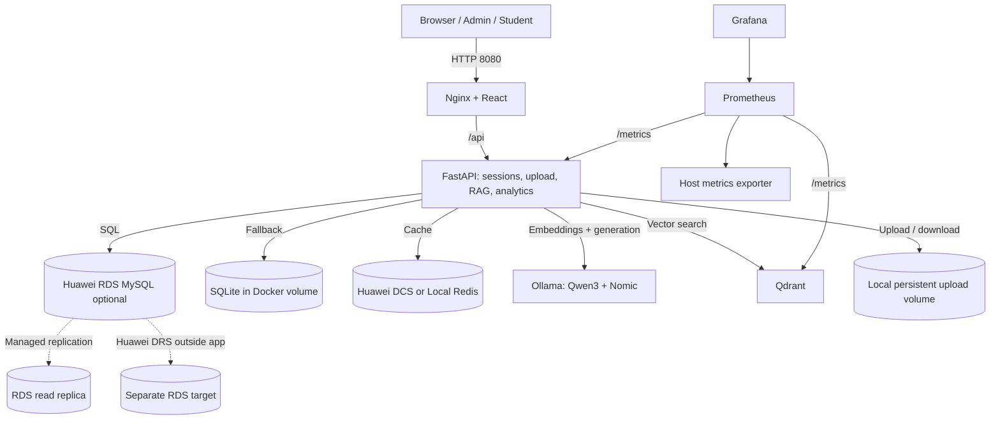

# Architecture and scope

## Responsibilities

1. **FastAPI** owns authentication, permissions, metadata, ingestion, chat history, and streaming responses. Database models in `backend/app/models.py`.
2. **RDS MySQL or SQLite** stores users, KBs, document metadata, chunk records, chat sessions/messages, query metrics, and audit events. It does not natively implement semantic vector search in this architecture.
3. **Qdrant** stores embeddings plus enough payload for citation retrieval. SQL chunk IDs and Qdrant point IDs match. Both must be backed up together.
4. **Ollama** runs a chat model and embedding model on the ECS CPU. `model-init` pulls models automatically. One active generation task is the sensible 8-GB starting limit.
5. **Redis / DCS** caches retrieval results, never confidential answers across unrelated KBs. Cache keys include the KB ID and index version.
6. **Local volume** stores original files, identified by generated UUID paths. No OBS is used.
7. **Prometheus/Grafana** collect API and host metrics; they do not automatically expose Cloud Eye/RDS/DCS/DRS performance counters. Add integrations if available.

## Document ingestion

Admin upload → validate extension/size → local file storage → SQL `queued` → extract text → break into overlapping chunks → Ollama `/api/embed` → Qdrant collection/index and upsert → SQL chunk rows → SQL `ready`. For a failed indexing operation, admin may retry. On restart interrupted `processing` jobs become `failed` and can be retried.

## RAG query

Signed-in user question → SQL chat message → embed question → Redis cached result or Qdrant semantic query (restricted to chosen KB) → construct bounded context with numbered source passages → Ollama `/api/chat` (thinking disabled, max token budget) → streamed answer → SQL answer/citation/latency records → Prometheus histograms.

## Knowledge-base access model

All logged-in users can read every KB and its documents. Only admin role creates KBs, uploads/deletes documents, and adds users. Conversations are per-user. This is a shared-classroom design, not granular enterprise authorization or multi-tenancy. The source KB ID is always applied to Qdrant retrieval filters, but it is not an authorization boundary among users in this version.

## Reliability caveats

- ECS is a single failure domain. RDS HA does **not** protect local vector/file data.
- `DB_MODE=auto` falls back at application startup only. It does not live-fail over or migrate data.
- SQL read replicas may lag; reporting deliberately tolerates stale reads.
- DRS is external to app and not a substitute for backup procedures.
- No asynchronous broker: ingestion jobs are FastAPI background tasks. Suitable for small classroom batches; use Celery/RQ + Redis and robust retry orchestration for larger deployments.
- CPU-only Qwen3 1.7B is limited in fluency and throughput. Retrieved passages shown in UI do not automatically prove every sentence of the model's answer is correct.
